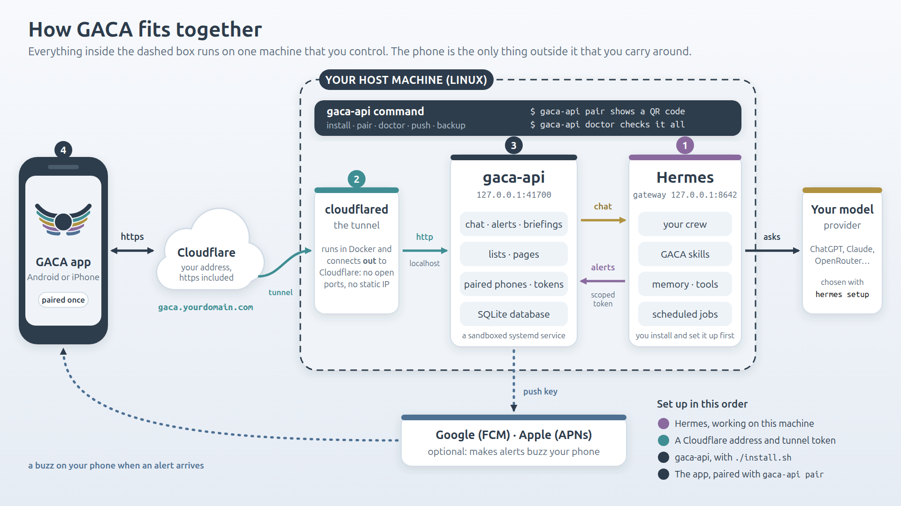

# GACA

A phone app for the AI agent you run yourself. GACA is a small server plus an Android and an iPhone app: your
[Hermes](https://github.com/NousResearch/hermes-agent) agent posts alerts, briefings and
pages to the app, and you chat with it from anywhere.

**One server belongs to one person.** You run it on a machine you control (next to Hermes), pair
your phone with it, and that is the whole account system: no sign-up, no passwords, no other users.



## Before you install gaca-api

**Work through these first.** `./install.sh` checks them and stops with the exact fix for anything missing, but it
will not do them for you. The picture above shows where each one lives.

1. **A Linux machine with systemd** that stays on, and that you can `sudo` on. This is the host in the picture;
   everything but the phone runs here.
2. **Hermes, installed, with a model provider signed in, and its API server running.** Required: GACA is the phone app for
   a Hermes agent, and without one the app has nothing to talk to. GACA does not install or configure Hermes (it has its own
   installer, upgrades and your model credentials). → [Set up Hermes](#set-up-hermes-once)
3. **Docker**, only to run the tunnel (`cloudflared`). Not needed if you skip the tunnel.
4. **An address your phone can reach.** For a permanent one: a free Cloudflare account, a domain on it, and a tunnel
   token. To just try it, a temporary `trycloudflare.com` address needs no account. → [Get an address (Cloudflare)](#get-an-address-cloudflare)
5. **A phone with the app on it**, Android or iPhone. → [Install the app](#install-the-app). Optional, and later:
   push notifications need a key from Google or Apple. → [Push notifications](#push-notifications-optional)

When those are done: [Install](#install), then [Pair your phone](#pair-your-phone).

## Best done with an agent

Setting all of this up goes much more smoothly alongside an AI agent that has **SSH access to the machine GACA will run on**.
It can read this README, run the installer, check Hermes, read `gaca-api doctor`, and fix what that reports, while you do the few
things only you can (Cloudflare sign-in, the model sign-in in `hermes setup`, scanning the QR code). See
[Handing the install to an agent](#handing-the-install-to-an-agent). You can do every step by hand too.

## Set up Hermes (once)

New to Hermes? [Hermes setup tips](docs/hermes-tips.md) covers the machine, the model sign-in, web search, memory, running it
as a service, approvals for unattended runs and more; GACA itself only needs the three things below.

1. Install it with Hermes's own installer, then choose your model provider:
   ```bash
   curl -fsSL https://hermes-agent.nousresearch.com/install.sh | bash
   hermes setup
   ```
   You need Hermes **0.21 or newer**. GACA is tested with **0.21.5 through 0.21.7**. The installer and
   `gaca-api doctor` warn (but carry on) if your Hermes is newer than that. Hermes 0.21.x's own skills
   list (`GET /v1/skills`) is broken; GACA reads the skill files directly instead, so the app's Skills tab
   still works.
2. Turn on Hermes's API server, which is how GACA talks to your agent. Add to `~/.hermes/.env`:
   ```
   API_SERVER_ENABLED=true
   API_SERVER_KEY=<any long random string>
   ```
   (`python3 -c "import secrets; print(secrets.token_urlsafe(32))"` makes one.)
3. Run the gateway as a service, keep it running after you log out, and check that it answers:
   ```bash
   hermes gateway install
   sudo loginctl enable-linger $USER     # without this, a user service stops when your last login ends
   curl http://127.0.0.1:8642/health
   ```

The GACA installer checks all of this before it changes anything, and stops with the exact fix for whatever
is missing. `./install.sh --install-hermes` will run Hermes's installer for you if it is not there (you still
run `hermes setup` yourself, because that is where your model credentials go).

## Get an address (Cloudflare)

Your phone reaches the server through a Cloudflare Tunnel: the server makes an outbound connection to Cloudflare, so
you open no ports and need no static IP. You choose how permanent the address is:

| | needs | address |
|---|---|---|
| **A permanent address** (recommended) | a free Cloudflare account and a domain whose DNS is on Cloudflare (buy one there, or add yours) | yours, e.g. `gaca.example.com`, never changes |
| **A temporary address** (to try it out) | nothing | a random `*.trycloudflare.com` that changes if the tunnel restarts: `--tunnel quick` |
| **None** | nothing | only reachable from this machine: `--tunnel none` |

For a permanent address, do this once in the Cloudflare dashboard **before** running the installer:

1. Open **Networks → Tunnels & Mesh** and create a tunnel (a *Cloudflared* tunnel). Name it anything.
2. **Find the token.** The page shows install commands for several systems. You do not need to run any of them. The token is
   the long string right after `--token` in any of those commands; the **copy**
   button next to **"Or, run tunnel (manual)"** copies the whole command, and you can paste that into the installer as it is.
   Do not confuse it with the tunnel's ID (a short `1234abcd-...` identifier), which does not work.
3. **Pause here.** The page will say *"Waiting for your Tunnel to connect"* and **Continue** stays greyed out. That is normal,
   nothing is wrong: the tunnel only connects once GACA's installer starts it (the Install step below). Leave the tab open
   and carry on to the installer. After it has started the tunnel, **Continue** lights up.
4. **Add the route**, on that same page or later from the tunnel's own page (open the tunnel, go to its **Routes** tab; the
   screen calls it a *published application route*): choose your domain (and a subdomain if you want one), and set the
   **Service URL** to **`http://localhost:41700`** (match the port exactly; `localhost:4700` is a common typo). Cloudflare creates the DNS
   record for you.
5. Give the installer the token and the hostname (it asks, or see the flags below).

Phones and iPhones need `https`, which you get automatically: Cloudflare serves your hostname over https with its own
certificate, and only the short hop from Cloudflare to `localhost` is plain http (inside your machine's tunnel, never over
the internet).

Cloudflare rearranges these screens from time to time; the names to look for are *Tunnels*, *token*, and *published application
route* (older screens call it a *public hostname*). When the installer finishes it checks `https://<your hostname>/api/health`
itself and says if it does not answer.

## Install

```bash
git clone <this repo> gaca && cd gaca
./install.sh
```

The installer is safe to re-run (it keeps your data and settings):

- checks Hermes (above) and puts GACA's skills into it (see [Hermes](#hermes));
- installs `uv` and the dependencies, writes `.env`, and starts `gaca-api` as a systemd service
  (sandboxed system service by default, which needs `sudo`; `--service user` needs no root and has no sandbox);
- brings up the tunnel: paste a Cloudflare tunnel token for a permanent address, or choose a temporary one;
- prints a **QR code**, waits for you to pair your phone, then gives Hermes its token for GACA.

Useful options: `--tunnel token|quick|none`, `--hostname gaca.example.com`, `--service system|user`,
`--install-hermes`, `--no-push`, `--no-hermes` (set up only the server, e.g. to try it without an agent). `./install.sh --help`
lists them all.

### Handing the install to an agent

This README is written so that you, or an AI agent working for you, can follow it top to bottom. An agent cannot do four things
for you, so have these ready or be at hand for them: **the Cloudflare steps** (above), **a sudo password** (unless sudo is passwordless;
or use `--service user`), **`hermes setup`** (your model provider sign-in), and **scanning the pairing QR code with your phone**.
Everything else runs without questions. On the machine itself, in the cloned repo:

```bash
# put the tunnel token in a file only you can read; never on a command line or in a chat
install -m 600 /dev/null ~/tunnel.token && $EDITOR ~/tunnel.token

./install.sh --yes --no-wait --no-push --tunnel token --hostname gaca.example.com --tunnel-token-file ~/tunnel.token
```

Add `--install-hermes` if Hermes is not installed yet, `--service user` if the machine has no sudo (no filesystem sandbox, said plainly),
and `--fcm-credentials FILE` or `--apns-key FILE --apns-key-id ID --apns-team-id ID --apns-topic BUNDLE_ID` for push. `--no-wait` stops
the installer waiting for a phone to pair, which an agent should not sit through.

It is always safe to run again. What the exit code means:

| code | meaning | what to do |
|---|---|---|
| 0 | done | `gaca-api doctor`, then `gaca-api pair` and have the person scan the QR (or open the printed `gaca://setup` link) |
| 1 | failed | the message says why |
| 3 | one step needs root | run the single command it prints (`sudo bash ~/.config/gaca/install-service.sh`), then run `./install.sh` again |
| 4 | Hermes is not ready | the message lists exactly what is missing and the fix; do it, then run `./install.sh` again |

`gaca-api doctor` is the check: exit status 0 means everything works, and each problem it reports comes with the fix.

## Install the app

| | get it | setup help |
|---|---|---|
| **Android** | build it from [gaca-android](https://github.com/damont/gaca-android) (`./gradlew installDebug`) | [gaca-android README](https://github.com/damont/gaca-android#readme) |
| **iPhone** | build it from [gaca-ios](https://github.com/damont/gaca-ios) (Xcode) | [gaca-ios README](https://github.com/damont/gaca-ios#readme) |

Those READMEs cover building, signing and push for each app. Using the app itself is the same on both.

## Pair your phone

Open the app, tap **Scan QR code**, and scan the code `gaca-api pair` shows. Run it on the
server any time you want to add a phone:

```bash
gaca-api pair                # a one-time code + QR, valid 10 minutes
gaca-api device list         # paired phones
gaca-api device revoke <id>  # unpair one
```

A phone talks to one server at a time (**Settings → Disconnect from this server** to switch). The QR also
works as a link, `gaca://setup?url=…&code=…`, and "Enter a code instead" takes the address and code by hand.

## Push notifications (optional)

Without push, alerts appear in the app whenever you open it. Push is what buzzes your phone. The installer asks
whether to set it up for **Android**, **iPhone**, or both, and asks for the key files it needs; run `./install.sh`
again any time to add one later.

| | you provide | from |
|---|---|---|
| Android | a service-account key file (JSON) | Firebase console → Project settings → Service accounts → Generate new private key |
| iPhone | a `.p8` key file, its Key ID, your Team ID, and the app's bundle id | Apple Developer portal → Keys (with the Apple Push Notifications service enabled) |

**The credentials must come from the same developer account your app was built with.** A push key can only message
the app it was made for: the Firebase project has to be the one in the app's `google-services.json`, and the Apple key has
to belong to the team that signed the app with that bundle id. So push works when you build the app yourself;
if you use someone else's build of the app, you still get your alerts in the app, but cannot push to it.

The key files are copied to `~/.config/gaca/secrets/` (owner-only) and only their paths go in `.env`; nothing secret
is printed. Non-interactive: `--fcm-credentials FILE`, or `--apns-key FILE --apns-key-id ID --apns-team-id ID
--apns-topic BUNDLE_ID`; `--no-push` skips the question. `gaca-api status` shows which are on.

## Hermes

Two things connect Hermes to GACA, both done by the installer and redone by `gaca-api hermes connect`:

- **A token per profile.** Each Hermes profile gets its own scoped, revocable token (alerts, briefings,
  artifacts only) in its `.env`. Hermes talks to GACA over `127.0.0.1`, never the public address.
- **Skills.** GACA's skills (the repo's `skills/`) are copied into every profile's `skills/gaca/` folder so the
  agent knows how to use GACA:

  | skill | teaches the agent to |
  |---|---|
  | `gaca` | reach GACA safely (local address, token, live API schema) and pick the right skill |
  | `gaca-alerts` | send alerts and permission requests to your phone instead of only the chat |
  | `gaca-briefing` | build the daily briefing in sections plus a summary, and schedule it |
  | `gaca-artifacts` | publish interactive pages (trackers, planners) that open in the app |
  | `gaca-heartbeat` | wake every 30 minutes, look at what it can see, and alert you only when something is worth it |

Profiles you create later, in the app or by hand, get both automatically. Re-running `./install.sh` (or
`gaca-api hermes connect`) after a `git pull` updates the skills; a skill file that an agent has edited is left
alone and reported, never overwritten. `gaca-api token list|revoke` manages the tokens.

**The heartbeat.** Once a phone is paired, the installer also schedules a Hermes cron job named `gaca-heartbeat` on
the default profile (every 30 minutes). Most runs end in silence. It never needs write access to anything: it only
suggests.

- **The limits are yours, and live in the app** (`GET`/`PUT /api/heartbeat/settings`): quiet hours (default 22:00 to
  07:00), at most 3 alerts a day with a gap between them, a daily run budget, a time zone, an on/off switch and a
  "pause until". The agent's token can read them but not change them, so it cannot raise its own cap. If GACA cannot
  supply them (an older server, or a token minted before the `heartbeat` scope existed: `gaca-api hermes connect
  --rotate` fixes that) the skill uses local defaults and still works.
- **The quiet log.** Each run ends by saying what it looked at and what it passed over and why. GACA's existing
  automation run history (`GET /api/crew/{name}/automations/{job_id}/runs`) already carries that as the run's summary,
  so there is no separate log to manage.
- **Schedule.** Set `GACA_HEARTBEAT_SCHEDULE` in the server's `.env` (a cron expression; empty means do not create
  the job) and re-run `gaca-api hermes connect`; an existing job is never overwritten, so to change one that exists
  edit or remove it with `hermes cron`.

## Day to day: the `gaca-api` command

The installer puts `gaca-api` on your PATH (it adds `~/.local/bin` to your shell's startup file; open a new
shell the first time) and it works from any directory.

| command | does |
|---|---|
| `gaca-api doctor` | checks everything (service, API, public address, paired phones, Hermes, its tokens and skills, push) and says how to fix what is wrong |
| `gaca-api pair` | a one-time code and QR code to pair another phone; `gaca-api device list` / `revoke <id>` |
| `gaca-api push status` | which push channels are on |
| `gaca-api push android` / `push ios` | set up (or replace) push after installing: asks for the key info, or take `--key FILE` (and for iPhone `--key-id`, `--team-id`, `--bundle-id`); `--restart` restarts the server for you |
| `gaca-api push remove android\|ios` | turn one off and delete its key |
| `gaca-api service status` / `restart` / `logs [-f]` | the systemd service, without remembering `systemctl` / `journalctl` flags (restart asks for sudo if it is a system service) |
| `gaca-api backup [FILE]` | a consistent copy of the database (your chats and paired phones) to a private file, safe while the server runs; default `~/gaca-backups/` |
| `gaca-api public-url [URL]` | show or set the address phones are told to use (it goes in the pairing QR code) |
| `gaca-api hermes connect` | redo the Hermes tokens and skills (also after `git pull`) |
| `gaca-api token list` / `create` / `revoke` | the scoped tokens Hermes uses |
| `gaca-api status` | owner, paired phones, push channels at a glance |

## Update and uninstall

```bash
git pull && ./install.sh              # update
./install.sh uninstall                # remove the service and tunnel, keep your data
./install.sh uninstall --purge        # ...and delete the data and settings
```

## Security model

- The server only listens on loopback; the tunnel is the only way in.
- The one public endpoint that matters is pairing: single-use codes that expire in minutes, are stored
  hashed, are burned after repeated wrong guesses, and are rate-limited per client.
- Phones and Hermes hold individually revocable credentials, stored hashed on the server. A Hermes token
  can only post and read what its scopes name; it cannot chat as you, manage devices, or mint tokens.
- Request size caps, security headers and rate limits are built into the API (there is no nginx).

## Development

```bash
cd gaca-api
uv sync
uv run pytest
GACA_AGENT_ENGINE=hermes GACA_DB_PATH=./dev.db uv run gaca-api     # serves on 127.0.0.1:41700
```

The chat screen design the apps follow is in [`docs/chat-design.md`](docs/chat-design.md); the live API schema is at
`/api/docs` on a running server.

## License

Apache License 2.0 (see [`LICENSE`](LICENSE)). Copyright 2026 David Monts.
